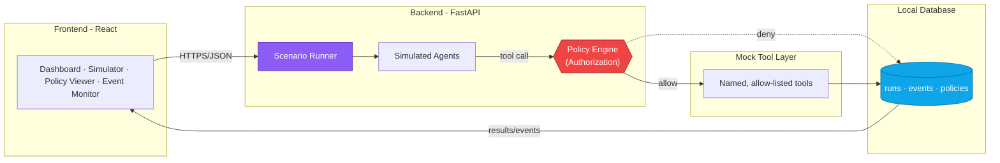

<div align="center">


<br/>


<br/><br/>

*A controlled sandbox for demonstrating AI-agent security risks, and proving that backend-enforced authorization can stop them.*

<br/>

[](https://www.python.org/)
[](https://nodejs.org/)
[](https://react.dev/)
[](https://fastapi.tiangolo.com/)
[](https://www.sqlite.org/)
[](https://owasp.org/www-project-top-10-for-large-language-model-applications/)
[](LICENSE)

<br/>

<a href="#about">About</a> •
<a href="#core-concept">Core Concept</a> •
<a href="#threat-scenarios">Scenarios</a> •
<a href="#architecture">Architecture</a> •
<a href="#tech-stack">Tech Stack</a> •
<a href="#getting-started">Getting Started</a> •
<a href="#security-boundaries">Boundaries</a> •
<a href="#team">Team</a>

</div>

<br/>

---

## &nbsp; About

**Agentraxis** *(agent + praxis, putting theory into practice)* is a controlled, educational platform for simulating selected AI-agent security risks and evaluating defensive controls against them.

From a single dashboard, you pick one of three predefined attack scenarios and run it against simulated agents and mock tools, once in **vulnerable mode**, once in **protected mode**, then compare real, stored results between the two.

> All scenarios use synthetic data and mock tools only. Agentraxis never touches real systems, real credentials, or a paid AI API.

<br/>

## &nbsp; Why Agentraxis

AI agents are increasingly trusted with tools, data, and the ability to call *other* agents, and that trust surface introduces risks that don't look like classic application vulnerabilities:

| Problem | What usually goes wrong |
|---|---|
| **Prompt injection** | An agent reads untrusted content and treats embedded instructions as commands |
| **Excessive permissions** | An agent is allowed to do more than its role actually needs |
| **Unsafe delegation** | One agent blindly trusts a request forwarded by another agent |

Agentraxis makes these risks visible, reproducible, and measurable in a safe classroom-scale environment, proving with real audit data that independent backend authorization, not an agent's own judgment, is what actually stops them.

<br/>

## &nbsp; Core Concept

<div align="center">

| | Vulnerable Mode | Protected Mode |
|---|:---:|:---:|
| Tool execution | Trusts the agent's own decision | Re-checked at the backend tool boundary |
| Unknown agent / tool / action | May proceed | **Denied by default** |
| Policy engine failure | N/A | **Fails closed** |
| Outcome | Attack typically succeeds | Attack is blocked and logged |

</div>

Both modes run on the **same scenario, same inputs, same mock tools**; only the authorization logic differs, which is what makes the before/after comparison meaningful.

<br/>

## &nbsp; Threat Scenarios

| # | Scenario | Risk Demonstrated | Control Demonstrated |
|:-:|---|---|---|
| 01 | **Prompt injection via document** | Hostile instruction embedded in text tries to trigger a restricted action | Untrusted-content handling + independent tool authorization |
| 02 | **Unauthorized data access** | Agent requests a record outside its permission scope | Least privilege + resource-level checks |
| 03 | **Unsafe agent-to-agent delegation** | Receiving agent trusts an unapproved forwarded request | Independent authorization at every tool boundary |

<br/>

## &nbsp; Key Features

- **Scenario runner** - launch any scenario in either mode, no code changes
- **Policy-enforced tool boundary** - identity, tool, action & resource validated before execution
- **Deny-by-default, fail-closed design** - nothing unknown is ever implicitly trusted
- **Full audit trail** - every decision logged with a reason and linked run
- **Event monitor** - filterable by run, scenario, mode, outcome
- **Metrics & comparison** - vulnerable vs. protected, calculated from real stored runs
- **Policy viewer/editor** - inspect and tweak the demo security policies
- **One-click reset** - restore seeded data & default policies

<br/>

## &nbsp; Architecture



> The **frontend never enforces authorization**, it only displays what the backend decided. Every protected-mode tool call is checked once, at the backend boundary, immediately before execution.

<br/>

## &nbsp; Tech Stack

<div align="center">

| Layer | Technology |
|---|---|
| Frontend | React |
| Backend API | Python · FastAPI |
| Agents & Policy Engine | Python |
| Data Store | SQLite (local, file-based) |
| Reference Standards | IEEE 830-1998 · ISO/IEC/IEEE 29148:2018 · OWASP LLM Top 10 |

</div>

<br/>

## Project Structure

```
agentraxis/
├── backend/     # API, policy engine, simulated agents, mock tools
├── frontend/    # Dashboard, simulator, policy & event-monitor UI
├── docs/        # SRS, project proposal, diagrams
├── .gitignore
├── LICENSE
└── README.md
```

<br/>

## &nbsp; Getting Started

```bash
# Clone
git clone https://github.com/<your-username>/agentraxis.git
cd agentraxis

# Backend (Python)
cd backend
python -m venv .venv && source .venv/bin/activate
pip install -r requirements.txt
uvicorn app.main:app --reload

# Frontend (Node.js)
cd ../frontend
npm install
npm run dev
```

<br/>

## &nbsp; Security Boundaries

Agentraxis is a **teaching tool, not a penetration-testing framework**:

- Every scenario is predefined, no free-form attack injection against real systems
- All records, documents, and tools are synthetic/mock
- Vulnerable mode never disables OS-level protections or reaches real endpoints
- No shell access, arbitrary code execution, or unrestricted filesystem tools
- Passing these tests doesn't prove resistance to all prompt-injection techniques; results apply only to this prototype, these scenarios, this test data

<br/>

## &nbsp; Documentation

- [`docs/Agentraxis.pdf`](docs/Agentraxis.pdf) - Agentraxis Project Proposal

<br/>

## &nbsp; Team

<div align="center">

| Name | Roll No. |
|---|:-:|
| Jabeen Zahra | 23L-3065 |
| Saim Arif Khan | 23L-3071 |
| Abdul Muiz | 23L-3097 |

**Advisor:** Ms. Sarah Abid Khan &nbsp;·&nbsp; **Course:** Information Security &nbsp;·&nbsp; **FAST-NUCES, Lahore**

</div>

<br/>

## License

Distributed under the [MIT License](LICENSE).